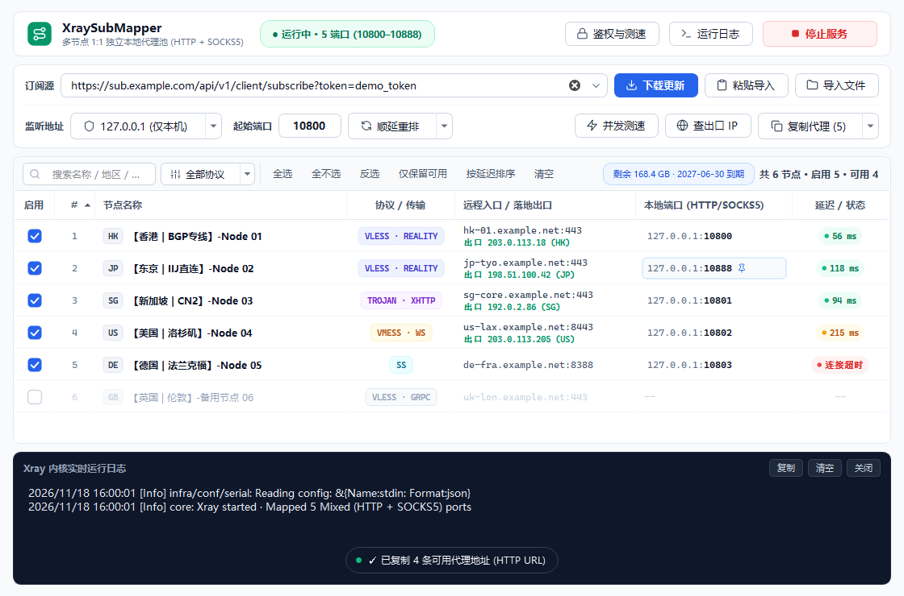

# XraySubMapper

[](https://www.microsoft.com/windows)
[](https://www.python.org/)
[-41CD52?style=flat-square)](https://pypi.org/project/PySide6-Essentials/)
[](LICENSE)

**XraySubMapper** 是一个专为 Windows 设计的轻量级多节点本地代理池映射工具。它能够从订阅链接、Clash YAML 配置或节点分享链接解析代理节点，并将每个节点 **1:1 映射为独立的本地混合代理端口（同端口自适应 `HTTP` + `SOCKS5` + `UDP`）**，开箱适配数据采集代理池、多环境自动化测试与指纹浏览器分流场景。



---

## 核心特性

- **1:1 独立双协议混合端口池**：
  - 节点 1 ➔ `127.0.0.1:10800`（同一端口同时支持 `http://` 与 `socks5://` 接入，支持 `SOCKS5 UDP ASSOCIATE`）
  - 节点 2 ➔ `127.0.0.1:10801`
  - 节点 N ➔ `127.0.0.1:10800 + N`
- **多协议与新传输层兼容**：
  - 原生支持 `VLESS`（含 `REALITY` / `XTLS-Vision` / `XHTTP` / `HTTPUpgrade`）、`Trojan`、`VMess`、`Shadowsocks`（含 `SS2022` 与 IPv6）、`Socks5`。
  - 自动识别标准 Base64 订阅、Clash / Mihomo YAML 配置及纯文本多行分享链接，自动提取 `Subscription-Userinfo` 流量与到期信息并过滤无效提示节点。
- **灵活的端口编排与锁定保护**：
  - 双击单元格可直接内联编辑单节点端口并自动打上 **端口锁定 (`PIN`)** 标识，顺延重排或增删节点时自动跳过已锁定端口；实时标红预警重复端口冲突。
  - 支持监听 `127.0.0.1`（仅本机）或 `0.0.0.0`（局域网共享），内置可选本地代理账号密码鉴权（同时保护 HTTP `407` 与 SOCKS5 `RFC1929`）。
- **并发真连接测速与落地出口探测**：
  - 基于 HTTPS `CONNECT` 隧道并发测量各本地端口的真实往返延迟，支持按延迟一键升序排列与“仅保留测速可用节点”。
  - 支持一键并发探测各端口的真实落地出口公网 IP 与国家代码，防止多实例业务串线。
- **零落盘安全架构与防孤儿进程**：
  - 通过内存 `stdin` 管道向 Xray 内核注入配置与校验，**不在磁盘落盘明文节点密钥配置文件**。
  - 绑定 Windows Job Object（`JOB_OBJECT_LIMIT_KILL_ON_JOB_CLOSE`），宿主异常崩溃或被强行终止时由系统内核自动回收 `xray.exe` 子进程，杜绝后台残留占用端口。
- **双模式运行**：同时提供基于 `PySide6` 的现代桌面工作台（支持配置变更一键平滑热重载、系统托盘驻留、拖拽/快捷键导入）与无界面 `CLI` 命令行模式。

---

## 快速开始

### 方式一：直接运行便携版 EXE（推荐）
前往 **[Releases](https://github.com/kjqg-cn/XraySubMapper/releases)** 页面下载单文件绿色便携版 `XraySubMapper.exe`，放入任意空目录双击即可开箱即用（已内置完整 Python 运行时与 Xray 内核，首次运行后自动生成本地配置与缓存文件）。
- *（可选）若需自定义或升级 Xray 内核版本，只需将特定版本的 `xray.exe` 放置在同级目录下，程序启动时将自动优先使用该外部内核。*

### 方式二：从源码运行

1. **克隆仓库并安装依赖**（需 Python `3.10+`）：
   ```bash
   git clone https://github.com/kjqg-cn/XraySubMapper.git
   cd XraySubMapper
   pip install -r requirements.txt
   ```
2. **放置 Xray 内核**：
   从官方 [XTLS/Xray-core Releases](https://github.com/XTLS/Xray-core/releases) 下载对应平台的 `Xray-windows-64.zip`，解压出 **`xray.exe`** 放置在项目根目录下（或加入系统 `PATH`）。
3. **启动桌面界面**：
   - 双击 `启动工具(免黑框).vbs`（无控制台窗口）或 `启动工具.bat`；
   - 或在终端执行：
     ```bash
     python main.py
     ```

### 方式三：命令行自动化模式（CLI）
```bash
# 从订阅链接下载并从 10800 端口开始映射
python main.py --sub "https://example.com/your-sub" --start-port 10800

# 启动后自动并发测速，并将测速可用的代理导出到 proxies.txt
python main.py --sub "https://example.com/your-sub" --start-port 10800 --test --export proxies.txt

# 从本地 Clash YAML 或节点文本文件读取并限制映射前 10 个节点
python main.py --file config.yaml --max-nodes 10 --listen 0.0.0.0
```

---

## 调用示例

映射启动后，每个本地端口均自适应支持 `HTTP` 与 `SOCKS5` 协议：

```python
import requests

# 同一端口既可走 HTTP 代理，也可走 SOCKS5 代理
proxies_http = {
    "http": "http://127.0.0.1:10800",
    "https": "http://127.0.0.1:10800",
}
print(requests.get("https://api.ipify.org?format=json", proxies=proxies_http).json())
```

```bash
# cURL 调用示例 (HTTP 与 SOCKS5 均可)
curl -x http://127.0.0.1:10800 https://api.ipify.org
curl -x socks5h://127.0.0.1:10800 https://api.ipify.org
```

---

## 自行打包单文件便携版

确保项目根目录下已放置官方 `xray.exe`，执行：
```bash
pip install pyinstaller
python build_portable.py
```
构建完成后将在 `release/XraySubMapper.exe` 生成纯净的单文件便携可执行程序。

---

## 项目结构

```text
XraySubMapper/
├── main.py                  # 统一入口 (GUI & CLI)
├── cli.py                   # 命令行守护运行模式
├── build_portable.py        # PyInstaller 单文件便携包构建脚本
├── requirements.txt         # Python 依赖声明
├── 启动工具.bat              # 终端启动脚本
├── 启动工具(免黑框).vbs       # Windows 无黑框启动脚本
├── core/
│   ├── parser.py            # 多协议链接与 Clash YAML 解析器
│   ├── subscription.py      # 订阅拉取、编码识别与流量元数据提取
│   ├── xray_manager.py      # Xray 内存管道启停、Job 守护、并发测速与出口探测
│   └── config.py            # 原子化配置与节点缓存持久化
├── gui/
│   ├── app.py               # PySide6 主窗口、热重载与托盘管理
│   ├── widgets.py           # Model/FilterProxy、抗锯齿自绘委托与悬浮 Toast
│   └── icons.py             # 多分辨率矢量 SVG 图标渲染器
└── tests/
    └── test_flow.py         # 协议解析与进程生命周期集成测试
```

---

## 致谢与免责声明

- **致谢**：本项目底层代理转发能力基于 [XTLS/Xray-core](https://github.com/XTLS/Xray-core)（`MPL-2.0`），桌面图形界面基于 [Qt for Python / PySide6](https://wiki.qt.io/Qt_for_Python)（`LGPLv3`）。
- **免责声明**：本工具仅限用于合法授权下的软件研发调试、多地域网络连通性测试与协议技术研究。使用者须严格遵守所在地法律法规，严禁将本工具用于任何违法违规用途，一切因不当使用产生的后果由使用者自行承担。

## License

Released under the [MIT License](LICENSE).
